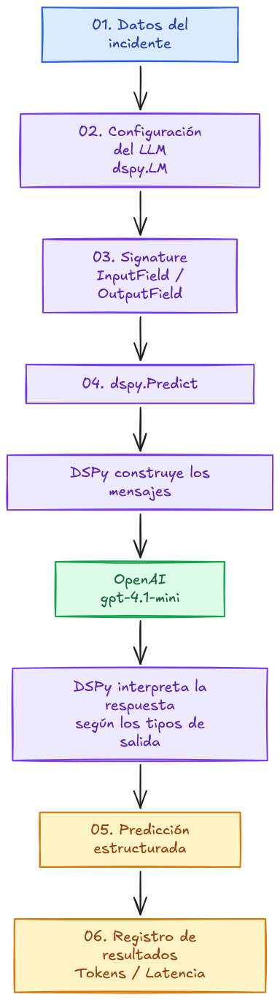
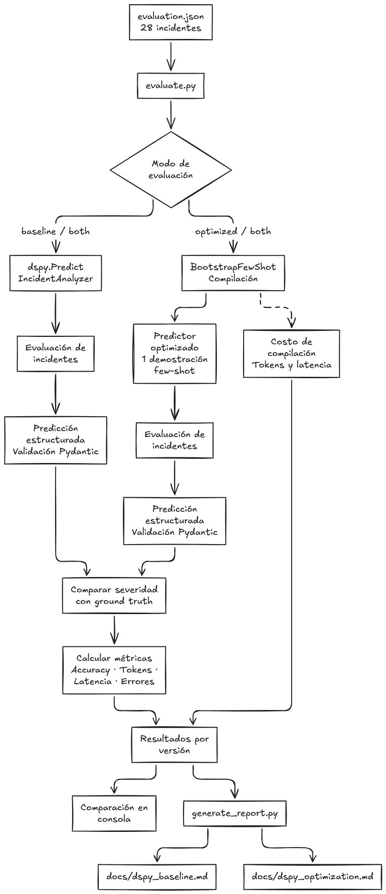

# DSPy Baseline

## 1. Flujo de ejecución

En esta implementación utilizamos **DSPy**, un framework que permite definir programas basados en modelos de lenguaje mediante componentes declarativos.

A diferencia del enfoque tradicional de Prompt Engineering, donde las instrucciones se escriben manualmente en archivos YAML, DSPy permite definir el comportamiento esperado mediante una **Signature** y ejecutar el modelo utilizando módulos como `dspy.Predict`.

El siguiente diagrama representa el recorrido de la información, desde que recibimos los datos de un incidente hasta que obtenemos la respuesta estructurada.



Este es el **flujo lógico de ejecución**. DSPy construye los mensajes necesarios para el LLM a partir de la Signature y sus campos de entrada y salida.

En esta versión baseline no utilizamos optimizadores ni demostraciones seleccionadas automáticamente.

---

## 2. ¿Qué sucede en cada etapa?

### 01. Recibimos los datos

El programa recibe la información necesaria para analizar el incidente:

- Descripción del incidente.

- Logs de la aplicación.

- Contexto del sistema.

- Despliegues recientes.

- Incidentes históricos.

- Impacto en el negocio.

- Políticas de severidad.

Estos datos constituyen el contexto que utilizará el modelo para generar su análisis.

### 02. Configuramos el modelo de lenguaje

DSPy utiliza un objeto `dspy.LM` para configurar el modelo que ejecutará las solicitudes.

Para mantener la comparación con la implementación tradicional, utilizamos:

- **Modelo:** `gpt-4.1-mini`

- **Temperature:** `0.0`

- **Cache:** `False`

La configuración permite que los módulos de DSPy utilicen el modelo seleccionado.

También habilitamos el seguimiento del consumo de tokens mediante `track_usage=True`.

### 03. Definimos la Signature

Una `Signature` especifica qué información recibe el modelo y qué información debe producir.

En nuestro caso, utilizamos `IncidentAnalyzer`, que define siete campos de entrada y diez campos de salida.

Los campos se declaran utilizando `dspy.InputField` y `dspy.OutputField`.

La Signature también contiene instrucciones generales relacionadas con:

- Clasificación del incidente.

- Evaluación de severidad.

- Identificación de causas raíz.

- Análisis de evidencias.

- Diferenciación entre hechos e hipótesis.

- Evaluación de confianza.

- Recomendación de acciones correctivas.

A diferencia de una plantilla YAML, no necesitamos construir manualmente todos los mensajes que se enviarán al LLM.

### 04. Ejecutamos `dspy.Predict`

El módulo `dspy.Predict` utiliza la Signature para preparar la solicitud al modelo.

```python

analyzer = dspy.Predict(IncidentAnalyzer)

```

DSPy genera las instrucciones y la representación de los campos utilizando su mecanismo de construcción de prompts.

El LLM recibe el contexto del incidente y genera los valores correspondientes a los campos de salida.

En esta etapa no se realiza optimización automática de instrucciones ni selección de ejemplos.

### 05. Obtenemos una respuesta estructurada

DSPy interpreta la respuesta del modelo según los tipos definidos en la Signature.

En nuestro caso, la predicción contiene:

- `category`

- `severity`

- `affected_components`

- `root_cause`

- `alternative_causes`

- `supporting_evidence`

- `missing_information`

- `corrective_actions`

- `confidence_score`

- `executive_summary`

El resultado se obtiene como una predicción de DSPy, cuyos campos pueden utilizarse directamente desde Python.

Posteriormente, utilizamos el modelo Pydantic `IncidentAnalysis` para validar la estructura del resultado.

Esto evita tener que procesar manualmente una respuesta de texto libre.

Sin embargo, la validación estructural no garantiza que la clasificación de severidad o el análisis técnico sean correctos.

### 06. Registramos los resultados

Finalmente, obtenemos el análisis generado y registramos las métricas disponibles de la ejecución:

- Tokens de entrada.

- Tokens de salida.

- Tokens totales.

- Latencia.

- Resultado de la clasificación.

También podemos inspeccionar el historial de solicitudes del modelo para observar los mensajes construidos por DSPy.

Estos datos permiten estudiar el comportamiento del baseline y compararlo con las implementaciones tradicionales.

---

## 3. ¿Dónde ocurre el Prompt Engineering?

En DSPy, las instrucciones se definen principalmente mediante la **Signature**, sus descripciones y los tipos de los campos.

El framework transforma esta definición declarativa en mensajes que pueden enviarse al modelo.

Es importante distinguir las responsabilidades de cada componente:

- **Signature:** define las entradas, las salidas y el objetivo de la tarea.

- **InputField / OutputField:** describen los campos que recibe y produce el modelo.

- **dspy.Predict:** ejecuta la tarea definida por la Signature.

- **dspy.LM:** configura el modelo de lenguaje utilizado.

- **Pydantic:** permite definir y validar estructuras de datos.

- **Python:** coordina la ejecución y registra los resultados.

En este enfoque, no necesitamos escribir manualmente un prompt completo con todos los mensajes.

Sin embargo, esto no significa que DSPy elimine el Prompt Engineering.

La calidad de la Signature, las descripciones de los campos y la configuración del modelo siguen influyendo en el comportamiento del sistema.

**En esta versión baseline, DSPy no optimiza automáticamente el programa.**

Este documento describe únicamente la implementación baseline con `dspy.Predict`.

---

## 4. Evaluación de DSPy

Una vez implementado el flujo de ejecución, necesitamos evaluar si las respuestas generadas cumplen con los resultados esperados.

Para ello utilizamos `evaluate.py`, que ejecuta el programa sobre un conjunto de incidentes previamente definidos.



El diagrama debe representar la evaluación del baseline de DSPy: ejecución, validación, comparación de severidad y registro de métricas.

Para cada incidente, el programa valida la respuesta estructurada, compara la severidad generada con la esperada y registra las métricas correspondientes.

Finalmente, `generate_report.py` utiliza los resultados para actualizar automáticamente los documentos Markdown.

### 01. Cargamos el dataset

El programa utiliza el conjunto de incidentes definido en:

`src/tradicional/evaluation.json`

El dataset contiene **28 incidentes**, cada uno con la información necesaria para realizar el análisis y una severidad esperada (**ground truth**).

Para garantizar una comparación consistente, el baseline de DSPy se evalúa sobre los mismos incidentes que las implementaciones tradicionales.

El mismo dataset permite comparar el baseline de DSPy con la implementación tradicional.

### 02. Ejecutamos el programa DSPy

Para cada incidente, utilizamos el siguiente flujo de ejecución:

1\. Preparar los datos de entrada.

2\. Ejecutar el módulo `dspy.Predict(IncidentAnalyzer)`.

3\. Obtener la predicción estructurada.

4\. Validar el resultado mediante `IncidentAnalysis`.

5\. Extraer la severidad generada.

6\. Registrar los tokens y la latencia.

El modelo de lenguaje se configura mediante `dspy.LM` antes de ejecutar la evaluación.

De esta manera, podemos observar cómo responde la misma Signature ante diferentes escenarios.

Para ejecutar la evaluación completa y actualizar el reporte:

```bash
python src/dspy/evaluate.py
```

### 03. Comparamos los resultados

Una vez obtenida la respuesta, `evaluate.py` compara la severidad generada por DSPy con la severidad esperada.

Por ejemplo:

| Severidad esperada | Severidad generada | Resultado |

|---|---|---|

| Critical | Critical | Correcto |

| High | Medium | Incorrecto |

| Low | Low | Correcto |

La evaluación se centra específicamente en el campo `severity`.

No estamos midiendo automáticamente la calidad de las causas raíz, las evidencias, las explicaciones o las acciones correctivas.

Sin embargo, validamos la estructura completa del resultado utilizando Pydantic.

Una respuesta que no supera esta validación se registra como una ejecución fallida.

### 04. Calculamos las métricas

La métrica principal es **Accuracy**, que representa la proporción de predicciones correctas.

[

Accuracy = \frac{\text{Predicciones correctas}}{\text{Total de incidentes}}

\]

Las solicitudes fallidas se consideran incorrectas para el cálculo de accuracy.

También registramos las siguientes métricas:

| Métrica | Descripción |

|---|---|

| Accuracy | Proporción de clasificaciones correctas |

| Input tokens | Tokens utilizados para las entradas |

| Output tokens | Tokens generados por el modelo |

| Total tokens | Consumo total de tokens |

| Average tokens | Promedio de tokens por incidente |

| Average latency | Tiempo promedio de ejecución |

| Failed requests | Ejecuciones que finalizaron con error |

Estas métricas permiten comparar tanto la calidad de clasificación como la eficiencia operativa.

El consumo de tokens se obtiene del historial registrado por `dspy.LM`.

Cuando una ejecución produce múltiples llamadas al modelo, sumamos los tokens registrados para esas llamadas.

El baseline utiliza únicamente inferencia con `dspy.Predict`.

### 05. Interpretamos los resultados

Los siguientes resultados corresponden a una ejecución previa de los 28 incidentes. Se actualizarán al ejecutar el evaluador y el generador de reportes nuevos.

El generador `generate_report.py` actualiza esta sección sin modificar el resto del documento.

<!-- RESULTS_START -->

## Evaluation Results

### Summary

| Metric | Value |
|---|---:|
| Severity accuracy | 100.00% |
| Total incidents | 28 |
| Successful requests | 28 |
| Failed requests | 0 |
| Correct predictions | 28 |
| Total tokens | 56401 |
| Average tokens | 2014.32 |
| Average latency (s) | 3.539 |

### Per-incident results

| Incident | Expected | Predicted | Correct | Category | Confidence | Tokens | Latency (s) |
|---|---|---|---|---|---:|---:|---:|
| INC-001 | Critical | Critical | PASS | Application | 0.75 | 2020 | 4.952 |
| INC-002 | High | High | PASS | Database | 0.75 | 2082 | 4.23 |
| INC-003 | Medium | Medium | PASS | Application | 0.65 | 1993 | 4.782 |
| INC-004 | Low | Low | PASS | Integration | 0.75 | 1980 | 3.612 |
| INC-005 | Critical | Critical | PASS | Integration | 0.8 | 2029 | 3.35 |
| INC-006 | High | High | PASS | Integration | 0.75 | 2030 | 3.928 |
| INC-007 | Medium | Medium | PASS | Application | 0.75 | 2049 | 3.567 |
| INC-008 | Low | Low | PASS | Application | 0.75 | 1962 | 3.402 |
| INC-009 | Low | Low | PASS | Infrastructure | 0.85 | 1929 | 2.819 |
| INC-010 | High | High | PASS | Integration | 0.75 | 2094 | 3.624 |
| INC-011 | Medium | Medium | PASS | Application | 0.75 | 1982 | 3.253 |
| INC-012 | Critical | Critical | PASS | Security | 0.85 | 2054 | 4.121 |
| INC-013 | Medium | Medium | PASS | Application | 0.65 | 2038 | 3.719 |
| INC-014 | Medium | Medium | PASS | Application | 0.75 | 1993 | 3.345 |
| INC-015 | Low | Low | PASS | Application | 0.75 | 1982 | 3.184 |
| INC-016 | Low | Low | PASS | Application | 0.75 | 1969 | 3.59 |
| INC-017 | High | High | PASS | Database | 0.75 | 2003 | 3.444 |
| INC-018 | Medium | Medium | PASS | Application | 0.75 | 2038 | 3.39 |
| INC-019 | Low | Low | PASS | Application | 0.75 | 2078 | 3.892 |
| INC-020 | High | High | PASS | Application | 0.85 | 1947 | 3.026 |
| INC-021 | Low | Low | PASS | Database | 0.75 | 1927 | 2.664 |
| INC-022 | High | High | PASS | Integration | 0.85 | 1939 | 3.05 |
| INC-023 | Low | Low | PASS | Application | 0.75 | 1993 | 3.292 |
| INC-024 | Medium | Medium | PASS | Integration | 0.75 | 2099 | 3.518 |
| INC-025 | High | High | PASS | Application | 0.75 | 2091 | 3.664 |
| INC-026 | Low | Low | PASS | Application | 0.75 | 2049 | 3.215 |
| INC-027 | High | High | PASS | Integration | 0.75 | 2062 | 3.326 |
| INC-028 | Low | Low | PASS | Database | 0.75 | 1989 | 3.126 |

> Accuracy measures severity classification only, not the correctness of root causes or evidence.

<!-- RESULTS_END -->

Una accuracy elevada no significa necesariamente que el programa sea perfecto.

La evaluación mide únicamente la clasificación de severidad sobre un conjunto limitado de incidentes.

Además, esta implementación no utiliza optimizadores de DSPy, por lo que sus resultados representan el comportamiento del programa baseline.

El consumo de tokens y la latencia también son importantes, ya que una implementación puede producir clasificaciones correctas, pero requerir más recursos para obtenerlas.

Estas métricas permiten contrastar el baseline con la implementación tradicional de Prompt Engineering.

### 06. ¿Por qué es importante esta etapa?

La ejecución permite comprobar que el programa DSPy funciona técnicamente.

La evaluación permite medir su comportamiento frente a resultados esperados.

Esto es fundamental para establecer una referencia (**baseline**) antes de incorporar optimizadores y comparar el rendimiento de distintos enfoques.

La comparación con el enfoque tradicional permite analizar:

- Si DSPy obtiene una clasificación de severidad más precisa.
- Cuánto aumenta o disminuye el consumo de tokens.
- Cómo cambia la latencia.
- Si las diferencias de precisión justifican el costo adicional.

El objetivo es evaluar la precisión de la clasificación y la eficiencia del baseline, sin asumir que una severidad correcta garantiza un análisis técnico correcto.
