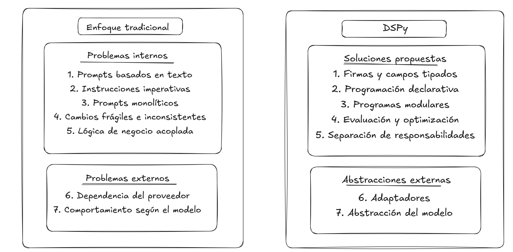

# Costos ocultos de Traditional Prompt Engineering

## 1. Introducción

Traditional Prompt Engineering presenta desafíos que van más allá
del consumo de tokens y del costo monetario.

Estos problemas pueden dividirse en dos categorías:

- **Internos:** relacionados con el diseño y mantenimiento del prompt.
- **Externos:** relacionados con los proveedores y modelos utilizados.

## 2. Comparación con DSPy

El diagrama muestra siete problemas del enfoque tradicional
y las herramientas que DSPy ofrece para abordarlos.

## 3. Análisis de los problemas

Traditional Prompt Engineering presenta desafíos que van más allá del consumo de tokens y los costos monetarios.

Estos desafíos pueden clasificarse en **problemas internos**, relacionados con la construcción y organización de los prompts, y **problemas externos**, relacionados con los proveedores y modelos de lenguaje.

### 3.1. Problemas internos

#### 3.1.1. Prompts basados en texto (String-based Prompts)

En el enfoque tradicional, los prompts suelen construirse mediante cadenas de texto, plantillas o archivos de configuración.

Las entradas, salidas y restricciones pueden definirse directamente dentro de las instrucciones, sin contar necesariamente con un contrato formal de tipos.

**Costos ocultos:**
- Dificultad para validar entradas y salidas.
- Riesgo de inconsistencias entre instrucciones y esquemas.
- Mayor esfuerzo para mantener contratos de datos.

**Enfoque DSPy:**

DSPy permite definir contratos estructurados mediante `dspy.Signature`, `dspy.InputField` y `dspy.OutputField`, utilizando tipos de Python y modelos Pydantic.

Esto facilita la definición y validación de los datos esperados.

---

#### 3.1.2. Instrucciones imperativas (Imperative Instructions)

En Traditional Prompt Engineering es frecuente describir detalladamente cómo debe realizarse una tarea mediante instrucciones secuenciales.

A medida que se agregan nuevas condiciones y reglas, estas instrucciones pueden volverse extensas, repetitivas o contradictorias.

**Costos ocultos:**
- Mayor complejidad de mantenimiento.
- Dificultad para modificar instrucciones sin afectar otras.
- Dependencia de ajustes manuales.

**Enfoque DSPy:**

DSPy promueve un estilo declarativo: se especifica **qué tarea debe realizarse**, cuáles son sus entradas y cuáles son sus salidas.

Los módulos, como `dspy.Predict` y `dspy.ChainOfThought`, permiten definir distintas estrategias de generación sin escribir manualmente todas las instrucciones.

---

#### 3.1.3. Prompts monolíticos (Monolithic Prompts)

Un prompt monolítico concentra múltiples responsabilidades dentro de un único conjunto de instrucciones.

Esto genera acoplamiento entre tareas que podrían desarrollarse, probarse y mantenerse de manera independiente.

**Costos ocultos:**
- Dificultad para localizar errores.
- Menor reutilización de componentes.
- Mayor complejidad de mantenimiento.
- Cambios que pueden afectar múltiples responsabilidades.

**Enfoque DSPy:**

DSPy permite dividir una aplicación en módulos especializados, cada uno con sus propias entradas, salidas y responsabilidades.

Esta organización favorece principios de ingeniería de software como **Single Responsibility Principle (SRP)** y **Separation of Concerns (SoC)**.

Sin embargo, dividir un proceso en múltiples llamadas al LLM puede incrementar el consumo de tokens y la latencia.

---

#### 3.1.4. Cambios frágiles e inconsistentes (Fragile and Inconsistent)

Los modelos de lenguaje pueden ser sensibles a modificaciones en la redacción, el orden o la estructura de las instrucciones.

Un cambio que mejora ciertos resultados puede perjudicar otros.

**Costos ocultos:**
- Necesidad de realizar pruebas de regresión.
- Dificultad para determinar qué modificación produjo un cambio.
- Experimentación manual repetitiva.
- Resultados potencialmente inconsistentes entre versiones.

**Enfoque DSPy:**

DSPy incorpora herramientas de evaluación y optimización que permiten utilizar datasets y métricas para comparar diferentes configuraciones.

Optimizadores como `BootstrapFewShot` permiten seleccionar ejemplos para mejorar el comportamiento del programa según una métrica definida.

Esto no elimina la variabilidad de los LLMs ni garantiza mejoras automáticas.

---

#### 3.1.5. Lógica de negocio acoplada (Business Logic Coupling)

En los prompts tradicionales, las reglas de negocio pueden quedar mezcladas con instrucciones de formato, generación y comportamiento del modelo.

Esto dificulta distinguir las responsabilidades del sistema y mantener las reglas de manera independiente.

**Costos ocultos:**
- Duplicación de reglas.
- Riesgo de instrucciones contradictorias.
- Dificultad para actualizar políticas.
- Mayor dependencia entre lógica de negocio y generación de texto.

**Enfoque DSPy:**

DSPy facilita la separación de responsabilidades mediante `Signatures`, módulos y composición de programas.

Las reglas deterministas pueden implementarse directamente en Python, mientras que los módulos DSPy se utilizan para tareas que requieren procesamiento mediante LLMs.

Esta separación depende del diseño de la aplicación y no ocurre automáticamente.

---

### 3.2. Problemas externos

#### 3.2.1. Dependencia del proveedor (Vendor-specific Prompts)

Los proveedores de modelos de lenguaje pueden ofrecer diferentes interfaces, formatos de mensajes y recomendaciones para estructurar instrucciones.

Por este motivo, una implementación puede necesitar ajustes al cambiar de proveedor o modelo.

**Costos ocultos:**
- Adaptación de prompts.
- Mantenimiento de diferentes configuraciones.
- Necesidad de verificar compatibilidad.
- Pruebas adicionales durante migraciones.

**Enfoque DSPy:**

DSPy incorpora adaptadores, como `ChatAdapter` y `JSONAdapter`, que permiten transformar las entradas y salidas declaradas en una `Signature` en formatos de interacción con el modelo.

Esto ayuda a separar la definición de la tarea de ciertos detalles del formato de los mensajes.

No garantiza que todos los proveedores funcionen de manera idéntica.

---

#### 3.2.2. Comportamiento según el modelo (Model-specific Behavior)

Los modelos de lenguaje pueden presentar diferencias en sus capacidades de razonamiento, interpretación de instrucciones, generación de formatos estructurados y consistencia.

Por lo tanto, utilizar las mismas instrucciones con modelos diferentes no garantiza obtener resultados equivalentes.

**Costos ocultos:**
- Evaluaciones adicionales al cambiar de modelo.
- Ajustes específicos de configuración.
- Posibles diferencias en calidad, latencia y consumo.
- Necesidad de mantener compatibilidad entre versiones.

**Enfoque DSPy:**

DSPy permite configurar modelos mediante `dspy.LM`, separando parcialmente la definición del programa de la elección del LLM.

Además, los programas pueden evaluarse y optimizarse nuevamente para distintos modelos.

La abstracción facilita la experimentación, pero no elimina las diferencias de comportamiento.

---

### 3.3. Costos transversales

Existen costos que afectan tanto al diseño interno como a las dependencias externas.

| Costo | Descripción |
|---|---|
| **Mantenimiento** | Esfuerzo para modificar instrucciones y conservar el comportamiento esperado. |
| **Testing y evaluación** | Creación de datasets, métricas y pruebas de regresión. |
| **Optimización** | Experimentación y ajuste de instrucciones, ejemplos o configuraciones. |
| **Colaboración** | Coordinación entre desarrolladores y especialistas de diferentes áreas. |
| **Curva de aprendizaje** | Conocimiento necesario sobre técnicas de prompting, modelos, proveedores y herramientas. |

DSPy puede reducir algunas tareas manuales, pero introduce nuevas responsabilidades relacionadas con el diseño de programas, las métricas y los procesos de optimización.

### 3.4. Conclusión

Los costos ocultos de Traditional Prompt Engineering pueden surgir tanto de la arquitectura de los prompts como de las dependencias externas del ecosistema de LLMs.

DSPy propone abordar parte de estas dificultades mediante programación declarativa, contratos estructurados, modularidad, adaptadores y optimización basada en evaluaciones.

**La diferencia fundamental no es que DSPy elimine estos problemas, sino que proporciona herramientas para gestionarlos de manera más sistemática.**