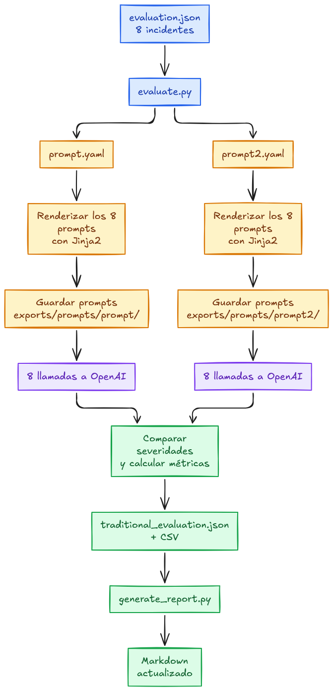

# Traditional Prompt Engineering

## 1. Flujo de ejecución

En esta primera implementación utilizamos un enfoque tradicional de Prompt Engineering, donde las instrucciones del LLM se definen manualmente en un archivo YAML.

El siguiente diagrama representa el recorrido de la información, desde que recibimos los datos de un incidente hasta que obtenemos la respuesta estructurada del modelo.

Este es el **flujo lógico de ejecución**. Hay un detalle importante: como utilizamos `client.beta.chat.completions.parse(response_format=IncidentAnalysis)`, la generación de la respuesta estructurada y su validación están integradas en la llamada al cliente de OpenAI. No necesitamos realizar una segunda llamada al LLM para validar el resultado.

## 2. ¿Qué sucede en cada etapa?

### 01. Recibimos los datos

El programa recibe la información necesaria para analizar el incidente: descripción, logs, contexto del sistema, despliegues recientes, incidentes históricos, impacto en el negocio y políticas de severidad.

Estos datos constituyen el contexto que utilizará el modelo para generar su análisis.

### 02. Cargamos `prompt.yaml`

Se carga el archivo `prompt.yaml`, que contiene las instrucciones diseñadas manualmente para orientar el comportamiento del LLM.

El archivo incluye tanto las instrucciones generales como los *placeholders* que permiten incorporar información dinámica.

### 03. Jinja2 construye el prompt

Jinja2 procesa la plantilla y reemplaza expresiones como `{{ incident_description }}` por los valores correspondientes.

Además, utilizamos `StrictUndefined` para detectar referencias a variables que no fueron proporcionadas durante el renderizado.

El resultado es un conjunto de mensajes con las instrucciones y el contexto necesarios para realizar la solicitud.

### 04. Enviamos la solicitud al LLM

Los mensajes generados se envían a `gpt-4.1-mini` mediante la API de OpenAI.

La solicitud también incluye el esquema de salida esperado, definido mediante el modelo Pydantic `IncidentAnalysis`.

El LLM procesa las instrucciones y el contexto para generar un análisis del incidente.

### 05. Obtenemos una respuesta estructurada

El SDK de OpenAI interpreta y valida la respuesta generada utilizando el esquema Pydantic `IncidentAnalysis`.

Esto permite trabajar con un objeto estructurado en Python, en lugar de procesar manualmente una respuesta de texto.

Si ocurre un error durante la generación o el parseo, la aplicación debe manejarlo adecuadamente.

### 06. Registramos los resultados

Finalmente, obtenemos el análisis generado y registramos las métricas disponibles de la ejecución, como el consumo de tokens y la latencia.

Estos datos permiten observar el comportamiento del sistema y comparar diferentes ejecuciones.

## 3. ¿Dónde ocurre el Prompt Engineering?

El Prompt Engineering ocurre principalmente durante el diseño y mantenimiento de `prompt.yaml`, antes de enviar la solicitud al modelo.

En este archivo definimos las instrucciones, las reglas y el comportamiento esperado.

Es importante distinguir las responsabilidades de cada herramienta:

- **YAML:** almacena las instrucciones.
- **Jinja2:** incorpora los datos dinámicos y construye los mensajes.
- **OpenAI / LLM:** procesa las instrucciones y genera la respuesta.
- **Pydantic:** define y valida la estructura de salida.
- **Python:** coordina la ejecución y registra los resultados.

En este enfoque, la calidad de las instrucciones depende principalmente del diseño manual del prompt. Jinja2 y Pydantic facilitan la construcción y validación de los datos, pero no optimizan automáticamente las instrucciones ni garantizan la calidad del razonamiento del modelo.

## 4. Evaluación del prompt

Una vez implementado el flujo de ejecución, necesitamos evaluar si las respuestas generadas por el LLM cumplen con los resultados esperados.

Para ello utilizamos `evaluate.py`, que permite ejecutar el mismo prompt sobre un conjunto de incidentes previamente definidos.

### 01. Cargamos el dataset

El programa lee `evaluation.json`, que contiene ocho incidentes de prueba.

Cada incidente incluye los datos necesarios para el análisis y una severidad esperada (*ground truth*), utilizada como referencia durante la evaluación.

### 02. Ejecutamos el prompt

Para cada incidente, se utiliza el mismo flujo de ejecución:

1. Cargar `prompt.yaml`.
2. Renderizar las instrucciones con Jinja2.
3. Enviar la solicitud al LLM.
4. Obtener la respuesta estructurada mediante `IncidentAnalysis`.

De esta manera, podemos observar cómo responde el mismo prompt ante diferentes escenarios.

### 03. Comparamos los resultados

Una vez obtenida la respuesta, `evaluate.py` compara la severidad generada por el modelo con la severidad esperada del dataset.

Por ejemplo:

| Severidad esperada | Severidad generada | Resultado |
|---|---|---|
| Critical | Critical | Correcto |
| High | Medium | Incorrecto |
| Low | Low | Correcto |

La evaluación se centra específicamente en el campo `severity`. No estamos midiendo automáticamente la calidad de las causas raíz, las evidencias o las acciones correctivas.

### 04. Calculamos las métricas

La métrica principal es **Accuracy**, que representa la proporción de predicciones correctas.

\[
Accuracy = \frac{\text{Predicciones correctas}}{\text{Total de incidentes}}
\]

También registramos métricas operativas, como el consumo de tokens y la latencia de las solicitudes.

### 05. Interpretamos los resultados

Los siguientes resultados se generan automáticamente a partir
de la última ejecución de `evaluate.py`.

<!-- RESULTS_START -->

#### Resultados de la evaluación

| Métrica | `prompt.yaml` | `prompt2.yaml` |
|---|---:|---:|
| Incidentes evaluados | 28 | 28 |
| Solicitudes exitosas | 28 | 28 |
| Solicitudes fallidas | 0 | 0 |
| Predicciones correctas | 27 | 25 |
| Accuracy | 96,4% | 89,3% |
| Tokens totales | 69.779 | 43.044 |
| Tokens promedio | 2.492,11 | 1.537,29 |
| Latencia promedio | 4,426 s | 3,111 s |

#### Clasificaciones incorrectas

| Versión | Incidente | Esperado | Predicho |
|---|---|---|---|
| prompt.yaml | INC-002 | High | Critical |
| prompt2.yaml | INC-002 | High | Critical |
| prompt2.yaml | INC-011 | Medium | Critical |
| prompt2.yaml | INC-020 | High | Critical |

<!-- RESULTS_END -->

Aunque el resultado sea del 100%, esto no significa que el
prompt sea perfecto. La evaluación contempla únicamente ocho
incidentes y mide específicamente la clasificación de severidad.

### 06. ¿Por qué es importante esta etapa?

La ejecución permite comprobar que el sistema funciona técnicamente.

La evaluación permite medir su comportamiento frente a resultados esperados.

Esto es fundamental para detectar regresiones cuando modificamos el prompt y para establecer una referencia (*baseline*) antes de comparar otros enfoques.